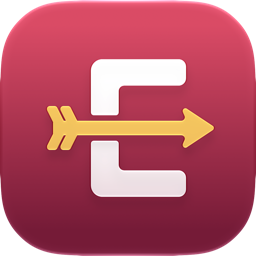

<p align="center">
  
</p>

<h1 align="center">Eros-SE</h1>

<p align="center">
  A native SwiftUI client for E-Hentai and ExHentai on iPhone, iPad and iPhone Duo.<br>
  <b>SE</b> stands for <i>Swift Edition</i>: a ground-up rewrite of the Flutter app
  <a href="https://github.com/erosTeam/eros_fe">Eros-FE</a>.
</p>

<p align="center">English · <a href="README.zh-CN.md">简体中文</a></p>

> [!WARNING]
> Eros-SE is in early development and has no release yet. Browsing, search, favorites and sign-in work;
> gallery details, the reader and downloads come in later milestones (see [Roadmap](#roadmap)).

## Lineage

Eros-SE is a rewrite of Eros-FE. It was developed in a private repository and starts here afresh, without that
repository's history:

| Project | What it is |
|---|---|
| [erosTeam/eros_fe](https://github.com/erosTeam/eros_fe) | **Eros-FE**, the Flutter E-Hentai client by honjow, 3003h and contributors, under the Apache License 2.0. The origin of Eros-SE's features and behavior. |
| A private working copy of Eros-FE | Eros-FE with an iPhone Duo adaptation and a Liquid Glass UI. |
| A private Swift rewrite | Eros-FE rewritten in Swift, milestone by milestone, against a parity ledger with Eros-FE. |
| **EHSwiftProject/eros_swifte** (this repository) | That rewrite, published as **Eros-SE** with the bundle ID `proj.eros.swifte` (2026-11-18). |

What Eros-SE takes from Eros-FE, and what it does not:

- **Rewritten, not translated.** No Dart code is part of the app. The architecture is new: SwiftUI, Swift 6 strict
  concurrency, and a Swift package (`ErosKit`) for models, HTML parsing, networking and storage.
- **Behavior follows Eros-FE.** The feature set, the user flows, the rules for reading the sites' pages and many
  details (such as the request limits for image hosts) follow Eros-FE. During development every Eros-FE feature is
  listed in a parity ledger, and each milestone checks off the ones it brings over. WebDAV sync (milestone M7) is
  planned to use Eros-FE's format, so both apps can share one sync folder.
- **Installs side by side.** Eros-SE has its own bundle ID, so it installs next to Eros-FE instead of replacing it.

## Features

Done (milestones M0–M2):

- Sign in with a password, with cookies, or on the site's own web page; nickname and avatar from the forum profile.
- Gallery lists with tabs you choose and order yourself: Gallery (with your own groups), Favorites, Toplists.
- Search: keywords, categories, advanced search, image search, saved quick searches, and tag suggestions.
- Tag translations from the EhTagTranslation database, downloaded and updated in the app.
- Open site links from other apps through `eros://`, or from the clipboard (off by default).
- Layouts for iPhone, iPad and iPhone Duo.

## Roadmap

| Milestone | Scope | Status |
|---|---|---|
| M0 | Foundation: project, page samples, DoH and WebDAV experiments, packaging | Done |
| M1 | Core: parsing, networking, sign-in | Done |
| M2 | Browsing: tabs, lists and groups, search, favorites, tag translations, external links | Done |
| M3 | Gallery details: info, thumbnails, ratings, tags, comments, torrents, archives | Planned |
| M4 | Reader | Planned |
| M5 | Downloads, ZIP and EPUB export | Planned |
| M6 | Account and settings | Planned |
| M7 | WebDAV sync, DoH and proxies | Planned |
| M8 | Polish: localization, accessibility, performance | Planned |

## Building

You need a Mac with Xcode 27.2 (iOS 27.2 SDK) and [XcodeGen](https://github.com/yonaskolb/XcodeGen)
(`brew install xcodegen`). The app runs on iOS 27 and later.

```bash
scripts/generate.sh     # generates Eros.xcodeproj from project.yml; then open it and pick the scheme "Eros"
scripts/test.sh         # every test: Swift packages on the Mac, app and UI tests on three simulators
scripts/build-ipa.sh    # an unsigned IPA at build/ipa/Eros.ipa
scripts/upload-asc.sh   # a signed upload to App Store Connect (needs EROS_TEAM_ID, your Apple Developer team)
```

The Xcode project, targets and scheme keep the name `Eros`; only the bundle ID and the name on the Home Screen are
Eros-SE.

- **Tests.** `scripts/test.sh` runs the Swift package tests on the Mac, then the app's unit and UI tests on an
  iPhone Duo, an iPhone and an iPad simulator, one at a time; a full run takes about three hours. The iPhone and iPad
  simulators are found by name (`iPhone (eros)`, `iPad (eros)`) and created when missing; point `EROS_SIM_UDID` at
  your own iPhone Duo simulator. UI tests run offline against checked-in page samples.
- **Installing.** There is no release yet. The IPA from `scripts/build-ipa.sh` is unsigned: sign it with your own tool
  (AltStore, Sideloadly and the like) before installing.
- **Page samples.** `Packages/ErosKit/Tests/Fixtures` holds real E-Hentai and ExHentai pages, captured with
  `Tools/FixtureCapture` and stripped of account data; tests check that no user name, member ID, API key or cookie
  value is left in them.

## Acknowledgments

- [Eros-FE](https://github.com/erosTeam/eros_fe) by [honjow](https://github.com/honjow),
  [3003h](https://github.com/3003h) and all its contributors: Eros-SE exists because of their work, and follows its
  design closely.
- The projects Eros-FE itself builds on: [E-HentaiViewer](https://github.com/kayanouriko/E-HentaiViewer) by
  kayanouriko and [EhViewer](https://github.com/seven332/EhViewer) by seven332.
- [EhTagTranslation/Database](https://github.com/EhTagTranslation/Database) for the tag translations. The app
  downloads them at run time; they are not part of this repository and are licensed under
  [CC BY-NC-SA 3.0](https://github.com/EhTagTranslation/Database/blob/master/LICENSE.md).
- Open-source libraries the app uses, all under the MIT License:
  [Nuke](https://github.com/kean/Nuke) (image loading and caching),
  [SwiftSoup](https://github.com/scinfu/SwiftSoup) (HTML parsing) and
  [GRDB.swift](https://github.com/groue/GRDB.swift) (SQLite).
- [XcodeGen](https://github.com/yonaskolb/XcodeGen), which generates the Xcode project.

## Disclaimer

Eros-SE is an unofficial client. It is not affiliated with or endorsed by E-Hentai or ExHentai, and it hosts no
content. The sites contain material for adults only. Use the app in line with the sites' terms and the laws where
you live.

## License

Eros-SE is licensed under the [Apache License 2.0](LICENSE), the same license as Eros-FE. See [NOTICE](NOTICE) for
attributions.
