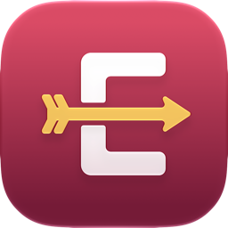

<p align="center">
  
</p>

<h1 align="center">Eros-SE</h1>

<p align="center">
  用 SwiftUI 原生编写的 E-Hentai / ExHentai 客户端，支持 iPhone、iPad 与 iPhone Duo。<br>
  <b>SE</b> 即 <i>Swift Edition</i>：Flutter 应用 <a href="https://github.com/erosTeam/eros_fe">Eros-FE</a>
  的 Swift 原生重写。
</p>

<p align="center"><a href="README.md">English</a> · 简体中文</p>

> [!WARNING]
> Eros-SE 仍在早期开发中，尚未发布。浏览、搜索、收藏与登录已可用；画廊详情、阅读器和下载在后续里程碑中实现（见[路线图](#路线图)）。

## 派生关系

Eros-SE 是 Eros-FE 的重写版本。重写在一个私有仓库中完成，本仓库从头开始，不带那个仓库的提交历史：

| 项目 | 说明 |
|---|---|
| [erosTeam/eros_fe](https://github.com/erosTeam/eros_fe) | **Eros-FE**，由 honjow、3003h 及各位贡献者开发的 Flutter 版 E-Hentai 客户端，Apache License 2.0。Eros-SE 的功能与行为均源自于此。 |
| Eros-FE 的私有工作副本 | 在 Eros-FE 基础上适配 iPhone Duo，改用 Liquid Glass 界面。 |
| 私有的 Swift 重写仓库 | 用 Swift 重写 Eros-FE，按里程碑推进，并用功能对齐台账逐项对照 Eros-FE。 |
| **EHSwiftProject/eros_swifte**（本仓库） | 上述重写以 **Eros-SE** 之名公开，bundle id 为 `proj.eros.swifte`（2026-11-18）。 |

Eros-SE 从 Eros-FE 继承了什么、没有继承什么：

- **重写而非移植**：App 里没有任何 Dart 代码。架构是全新的：SwiftUI、Swift 6 严格并发检查，模型、HTML 解析、网络与存储放在 Swift
  包 `ErosKit` 中。
- **行为对齐 Eros-FE**：功能范围、操作流程、站点页面的解析规则以及许多细节（例如图片服务器的请求限频）都以 Eros-FE 为准。
  开发过程中，Eros-FE 的每项功能都列在功能对齐台账里，每个里程碑勾掉自己搬过来的那些。WebDAV 同步（M7）计划沿用 Eros-FE
  的格式，两个 App 可以共用同一个同步目录。
- **可以并存**：Eros-SE 使用独立的 bundle id，与 Eros-FE 同时安装，互不覆盖。

## 功能

已完成（M0–M2）：

- 登录：账号密码、cookie，或在站点自己的网页上登录；昵称与头像取自论坛资料页。
- 画廊列表，标签页可自选、自排：画廊（含自定义分组）、收藏、排行榜。
- 搜索：关键词、分类、高级搜索、以图搜图、保存的快速搜索，以及标签联想。
- 标签翻译：使用 EhTagTranslation 数据库，在 App 内下载与更新。
- 外部入口：其他 App 可通过 `eros://` 打开站点链接；也可检测剪贴板里的链接（默认关闭）。
- 适配 iPhone、iPad 与 iPhone Duo 的布局。

## 路线图

| 里程碑 | 范围 | 状态 |
|---|---|---|
| M0 | 地基：工程、页面样本、DoH 与 WebDAV 实验、打包 | 已完成 |
| M1 | 核心：解析、网络、登录 | 已完成 |
| M2 | 浏览：标签容器、列表与分组、搜索、收藏、标签翻译、外部入口 | 已完成 |
| M3 | 画廊详情：信息、缩略图、评分、标签、评论、种子、归档 | 计划中 |
| M4 | 阅读器 | 计划中 |
| M5 | 下载，导出 ZIP 与 EPUB | 计划中 |
| M6 | 账号与设置 | 计划中 |
| M7 | WebDAV 同步、DoH 与代理 | 计划中 |
| M8 | 打磨：本地化、无障碍、性能 | 计划中 |

## 构建

需要一台装有 Xcode 27.2（iOS 27.2 SDK）和 [XcodeGen](https://github.com/yonaskolb/XcodeGen)（`brew install xcodegen`）的
Mac。App 支持 iOS 27 及以上。

```bash
scripts/generate.sh     # 由 project.yml 生成 Eros.xcodeproj，打开后选择 scheme「Eros」
scripts/test.sh         # 全部测试：Mac 上的 Swift 包测试，以及三台模拟器上的 App 与 UI 测试
scripts/build-ipa.sh    # 产出未签名 IPA：build/ipa/Eros.ipa
scripts/upload-asc.sh   # 签名并上传到 App Store Connect（需设置 EROS_TEAM_ID，即你的 Apple Developer 团队）
```

Xcode 工程、target 与 scheme 仍沿用 `Eros` 这个名字，只有 bundle id 和主屏幕上的名称是 Eros-SE。

- **测试**：`scripts/test.sh` 先在 Mac 上跑 Swift 包测试，再依次在 iPhone Duo、iPhone、iPad 三台模拟器上跑 App 的单元测试与
  UI 测试，全量约 3 小时。iPhone 与 iPad 模拟器按名字（`iPhone (eros)`、`iPad (eros)`）查找，没有就自动创建；iPhone Duo
  模拟器请用 `EROS_SIM_UDID` 指定你自己的那台。UI 测试离线运行，由入库的页面样本应答。
- **安装**：目前尚无发布版本。`scripts/build-ipa.sh` 产出的 IPA 未签名，需要先用自己的工具（AltStore、Sideloadly 等）签名再安装。
- **页面样本**：`Packages/ErosKit/Tests/Fixtures` 存放用 `Tools/FixtureCapture` 采集的 E-Hentai / ExHentai 真实页面，已去除账号数据；
  测试会检查其中没有残留用户名、member id、API key 或 cookie 值。

## 致谢

- [Eros-FE](https://github.com/erosTeam/eros_fe) 的作者 [honjow](https://github.com/honjow)、[3003h](https://github.com/3003h)
  及全体贡献者：没有他们的工作就没有 Eros-SE，Eros-SE 的设计也紧随 Eros-FE。
- Eros-FE 自身所参考的项目：kayanouriko 的 [E-HentaiViewer](https://github.com/kayanouriko/E-HentaiViewer) 与
  seven332 的 [EhViewer](https://github.com/seven332/EhViewer)。
- [EhTagTranslation/Database](https://github.com/EhTagTranslation/Database) 提供标签翻译。数据由 App 运行时下载，不包含在本仓库中，
  采用 [CC BY-NC-SA 3.0](https://github.com/EhTagTranslation/Database/blob/master/LICENSE.md) 协议。
- App 使用的开源库，均为 MIT 许可证：[Nuke](https://github.com/kean/Nuke)（图片加载与缓存）、
  [SwiftSoup](https://github.com/scinfu/SwiftSoup)（HTML 解析）、[GRDB.swift](https://github.com/groue/GRDB.swift)（SQLite）。
- 用来生成 Xcode 工程的 [XcodeGen](https://github.com/yonaskolb/XcodeGen)。

## 免责声明

Eros-SE 是非官方客户端，与 E-Hentai、ExHentai 无任何关联，也未获其认可，本身不托管任何内容。这些站点的内容仅面向成年人。
请遵守站点条款及所在地的法律使用本 App。

## 许可证

Eros-SE 采用 [Apache License 2.0](LICENSE) 授权，与 Eros-FE 相同。署名信息见 [NOTICE](NOTICE)。
